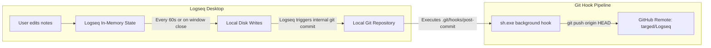

# Design Specification: Logseq Git Backup & Auto-Push Architecture

## 1. Overview & Goal

The objective is to establish automated, robust, zero-maintenance Git version control and remote backup for Logseq notes on Windows.

The target repository is `C:\Users\ltkli\Documents\GitHub\Logseq`, linked to remote `https://github.com/targed/Logseq.git`. The solution uses Logseq's native version control combined with a lightweight Git `post-commit` hook, requiring **zero third-party plugins** and **no background daemons**.

---

## 2. Architecture & File Topology

### 2.1 Separation from Google Drive
* **Current State**: The active graph is located at `C:\Users\ltkli\My Drive\DriveSyncFiles\My Graph`.
* **Issue**: Hosting a Git repository inside a cloud-sync directory (Google Drive, Dropbox, OneDrive) causes file-locking collisions on `.git/index.lock`, silent commit failures, and internal Git object database corruption.
* **Target State**: The active working directory is migrated entirely to `C:\Users\ltkli\Documents\GitHub\Logseq`. Git/GitHub becomes the single source of truth for versioning and offsite backup.
* **Google Drive Retention**: The existing Google Drive folder is preserved as a static pre-migration backup until the new setup is validated.

### 2.2 Component Data Flow



---

## 3. Migration & Configuration Details

### 3.1 Repository Layout & `.gitignore`
In `C:\Users\ltkli\Documents\GitHub\Logseq`:
* Logseq directories (`pages/`, `journals/`, `logseq/`, `assets/`) copied from `C:\Users\ltkli\My Drive\DriveSyncFiles\My Graph`.
* A tailored `.gitignore` ensures Logseq's local cache and transient backups don't pollute Git history:
  ```gitignore
  # Logseq local backups & transient cache
  logseq/.recycle/
  logseq/bak/
  .DS_Store
  Thumbs.db
  desktop.ini
  ```

### 3.2 Git `post-commit` Hook Implementation
Located at `C:\Users\ltkli\Documents\GitHub\Logseq\.git\hooks\post-commit`:
* **Shell interpreter**: Executed by `sh.exe` provided by Git for Windows.
* **Line endings**: Strictly formatted with Unix LF (`\n`) to prevent Windows interpreter errors.
* **Script contents**:
  ```sh
  #!/bin/sh
  # Disable interactive credential prompts to prevent hanging
  export GIT_TERMINAL_PROMPT=0

  # Push latest committed state to GitHub silently, logging errors to post-commit.log
  git push origin HEAD > "$GIT_DIR/post-commit.log" 2>&1
  ```

### 3.3 Logseq Application Configuration
* Graph location pointed to `C:\Users\ltkli\Documents\GitHub\Logseq`.
* **Settings > Version Control**:
  * `Enable Git auto commit`: Enabled
  * `Git commit on window close`: Enabled
  * `Git auto commit seconds`: `60`

---

## 4. Multi-Device & Cloud Sync Evaluation (Git vs. Google Drive)

### 4.1 Git vs. Google Drive for Notes
* **Google Drive**:
  * *Pros*: Simple drag-and-drop file storage.
  * *Cons*: Prone to sync conflicts (creates duplicate files like `MyNote (1).md` when edited offline or during slow network syncs); cannot track block-level diffs or revision history cleanly; incompatible with Git inside the synced tree.
* **GitHub / Git**:
  * *Pros*: Full atomic history, cryptographic data integrity, clear commit logs, rollback capabilities, free private hosting, immune to silent cloud-drive overwrites.
  * *Cons*: Requires pull before editing if notes are edited across multiple devices.

### 4.2 Future Cross-Device Strategy
* **Desktop / Laptop to Desktop / Laptop**: Highly viable with Git. Adding a lightweight `pre-launch` pull script or running `git pull` on the second machine brings it up to date instantly with zero conflict danger.
* **Mobile (iOS / Android)**:
  * On iOS, the Logseq app requires either official Logseq Sync or third-party git clients (e.g., Working Copy).
  * On Android, tools like Termux or MGit can sync Git repositories.
  * *Verdict*: For mobile, official Logseq Sync or keeping read-only exports is cleaner than mobile Git. For desktop environments, Git is vastly superior to Google Drive.

---

## 5. Verification Plan

1. **Migration Verification**:
   * Verify all Markdown pages, journals, assets, and config files from `My Graph` are present in `C:\Users\ltkli\Documents\GitHub\Logseq`.
2. **Initial Remote Push**:
   * Execute manual `git push origin master` (or `main`) and verify visibility on `https://github.com/targed/Logseq`.
3. **Hook Verification**:
   * Create a dummy commit and verify `post-commit` executes without prompt and updates GitHub.
4. **Logseq Live Test**:
   * In Logseq, create/modify a test block.
   * Wait 60 seconds (or close Logseq).
   * Confirm commit in `git log` and confirm push in `git status` / GitHub web interface.
