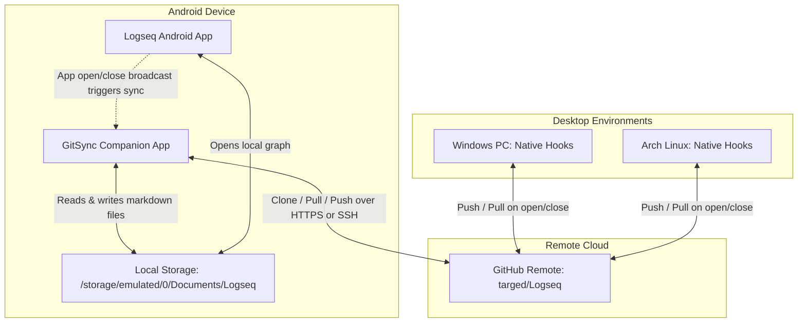

# Design Specification: Logseq Android Git Synchronization via GitSync

## 1. Overview & Goal

The objective is to achieve reliable, automated two-way synchronization for Logseq on Android with the remote repository [`targed/Logseq`](https://github.com/targed/Logseq), creating an unified note-taking workflow across **Windows**, **Linux**, and **Android**.

We will use **GitSync** ([`ViscousPot/GitSync`](https://github.com/ViscousPot/GitSync)), an open-source mobile Git client designed specifically for Markdown note systems (Logseq and Obsidian). It automates pull operations when opening Logseq and commit/push operations when closing Logseq, requiring **zero mobile command-line usage**.

---

## 2. Architecture & Data Flow

### Key Architectural Properties
1. **Cloud Independence**: The phone syncs directly to GitHub via Wi-Fi or mobile data; desktop machines do not need to be powered on.
2. **True Git Versioning**: Retains all commit history, diffs, and rollback capabilities. Eliminates Google Drive / DriveSync file collisions (`Note (1).md`).
3. **Transparent Filesystem**: Notes live in regular device storage (`Documents/Logseq`), meaning no root access or proprietary containers are required.

---

## 3. Configuration & Component Specifications

### 3.1 Application Installation & Permissions
* **Source**: Google Play Store ("GitSync" by ViscousPotential) or GitHub Releases APK.
* **Storage Permission**: All Files Access (`MANAGE_EXTERNAL_STORAGE`) to allow reading and writing the repository in `Documents/Logseq`.
* **Battery Optimization**: Set to **Unrestricted** in Android System Settings $\rightarrow$ Apps $\rightarrow$ GitSync $\rightarrow$ Battery, ensuring Android Doze does not kill background syncs.

### 3.2 Authentication & Repository Setup
* **Remote URL**: `https://github.com/targed/Logseq.git`
* **Authentication Method**: GitHub OAuth (recommended for 1-click token generation) or a GitHub Personal Access Token (PAT) with `repo` scope.
* **Local Clone Path**: `Documents/Logseq` (or standard shared storage root).

### 3.3 Automation Rules in GitSync
* **Target Application**: Set target application to **Logseq**.
* **Trigger on Launch**: Enable automatic `git pull --rebase` whenever Logseq is brought to the foreground.
* **Trigger on Exit**: Enable automatic `git add .`, `git commit -m "mobile sync: <timestamp>"`, and `git push` when Logseq is closed or minimized.
* **Periodic Fallback**: Optional background sync every 1–2 hours.
* **Quick Settings / Widget**: Add GitSync tile to Android notification shade for optional 1-tap manual sync.

### 3.4 Logseq Configuration on Android
* **Graph Path**: Point to the folder cloned by GitSync (`Documents/Logseq`).
* **Initial Re-index**: Run initial full graph re-index to build local SQLite and transit caches.

---

## 4. Conflict Handling & Edge Cases

* **Conflict Detection**: If an edit was made on desktop and phone simultaneously without syncing, GitSync's built-in 3-way visual merge tool pops up to allow block-by-block resolution on mobile.
* **Offline Editing**: If edited while offline, GitSync queues the commit locally and pushes as soon as network connectivity is restored.

---

## 5. Decommissioning DriveSync
Once the GitSync flow is verified on Android:
1. Turn off synchronization in the Android **DriveSync** app for `My Graph`.
2. Uninstall or disable DriveSync.
3. The original Google Drive folder on the cloud remains preserved as a static historical archive.
